# Sanfelice Studio

**Live site: [sanfelice-studio.caio-h-sampaio.workers.dev](https://sanfelice-studio.caio-h-sampaio.workers.dev/)**

Portfolio website for Sanfelice Studio, the London-based practice of photographer and image-maker Caio Sanfelice. Built with HTML, CSS, Bootstrap 5 and vanilla JavaScript as the WAES Full Stack Bootcamp HTML, CSS & Bootstrap project.

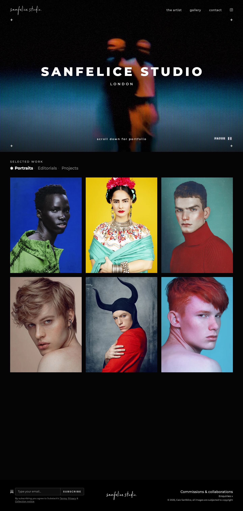

## Table of Contents

1. [Purpose](#purpose)
2. [User Stories](#user-stories)
3. [Pages](#pages)
4. [Features](#features)
5. [Technologies](#technologies)
6. [Design](#design)
7. [Screenshots](#screenshots)
8. [Testing](#testing)
9. [Bugs and Fixes](#bugs-and-fixes)
10. [Deployment](#deployment)
11. [Credits](#credits)
12. [Use of AI](#use-of-ai)
13. [Future Updates](#future-updates)

## Purpose

The site presents Caio Sanfelice's work across portrait, editorial and project photography, introduces the artist and his services, and gives clients a simple way to get in touch for commissions and collaborations.

It is built for:

- **Clients and agencies** looking for a photographer, make-up artist or set designer: they can browse the work by category, read about the services and send an enquiry.
- **Editors and collaborators**: published covers (Vogue Italia PhotoVogue, GMARO, Boys Magazine and others) show the work's track record at a glance.

## User Stories

Written at the planning stage, before coding. The right-hand column shows how the finished site meets each one.

### Visitor (brand, model, collaborator)

| User story | How the site delivers it |
|---|---|
| As a visitor arriving via referral, when I open the site I want a striking full-screen image with the studio name, so I grasp the level of the work within 2 seconds. | Full-screen hero with the studio name over a background video; the text appears in under 1 second (Lighthouse First Contentful Paint). |
| As a visitor, I want to see a curated selection of the 6–8 best pieces on the Home page, so I get a strong first impression without scrolling much. | "Selected work" grid right below the hero, reached with one scroll or the "scroll down for portfolio" link (9 pieces, to fill the 3-column grid). |
| As a brand owner, I want to filter the gallery by category (Fashion · Beauty · Still Life · Portraits), so I can find examples similar to my project. | Category menu above every gallery. The final categories became **Portraits · Editorials · Projects**, each on its own page, to match the work published so far. |
| As a visitor, I want each photo displayed large and clean (no visual clutter), so I can genuinely assess the image quality. | Clicking a photo opens it full size in a lightbox, on a near-black background with only the copyright line. |
| As a visitor, I want a Services page showing what he does (photoshoot, beauty, set design, creative direction), so I understand the scope beyond the camera. | The services (Photography, Beauty, Set Production, Stage & Screen) are cards on **The Artist** page, each with a photo and a description, right below the biography. |
| As a visitor, I want to know who the photographer is (portrait + story + London base), so I can trust the person behind the work. | The Artist page: full-width portrait, biography (education, publications, London studio) and a quote. |
| As a visitor, I want clear links to Instagram and Substack, so I can follow his ongoing work. | Instagram icon in the navbar on every page; Substack newsletter sign-up in the footer on every page. |
| As a visitor, I want contact (WhatsApp/email) always one click away, so I can respond to the referral on the spot. | The navbar stays on screen while scrolling, with Contact always visible; the Contact page has WhatsApp, email, the form and the map. The footer's "Enquiries »" link also leads there. |
| As a visitor on mobile, I want every page to work well on a small screen, because the site almost always arrives via a WhatsApp/DM link. | Mobile-first responsive layout with the Bootstrap grid, tested from 360 px; Lighthouse mobile scores 92–95 for Performance on most pages and 100 for Accessibility. |
| As a visitor, I want the site to load fast (optimized images), so I don't give up before the second photo. | WebP images, lazy loading below the fold, and the video effect starts only after the page has loaded. Editorials on mobile (80) is the one page still to optimise. |

### Photographer (site owner)

| User story | How the site delivers it |
|---|---|
| As the photographer, I want to swap/add photos in the gallery in a simple way (replacing files), so I can keep the portfolio updated without touching code. | Gallery photos are plain files in `assets/images/`; replacing a file with one of the same name updates the site on the next push (only the `width`/`height` in the HTML need updating if the proportions change). |
| As the photographer, I want the site's look to reflect my visual identity (palette, typography, spacing), so the site feels like part of my work, not a template. | Custom dark palette and type defined as CSS variables, the script logo, the VHS video effect and the split-flap details; Bootstrap is used for layout only, not for its default look. |

## Pages

| Page | File | What it shows |
|---|---|---|
| Home | `index.html` | Video hero with the studio name, and a selected-work gallery |
| The Artist | `aboutme.html` | Biography with a full-width portrait, and the four services (Photography, Beauty, Set Production, Stage & Screen) as expandable cards |
| Portraits | `portraits.html` | Portrait gallery |
| Editorials | `editorials.html` | Editorial work and magazine covers |
| Projects | `projects.html` | Personal and commissioned projects |
| Contact | `contact.html` | Contact form, map, phone, email and address |

The navigation bar and the footer are shared components (`components/navbar.html`, `components/footer.html`) loaded into every page by `assets/js/components.js`, so they are written once.

## Features

**Navigation**
- Fixed navigation bar (Bootstrap `fixed-top`): transparent over the hero, with a dark background once the page scrolls, so the menu is always available.
- The current page is highlighted in the menu.
- "Skip to content" link for keyboard users.

**Hero**
- Background video with a live VHS / analog effect drawn in WebGL (noise, scanlines, tape tracking).
- The video only starts after the page has loaded, and never plays for users who ask their device for reduced motion (the still poster image shows instead).
- Pause / play button for the video.
- The studio name tilts gently as the hero scrolls away.
- "Scroll down for portfolio" animates like a split-flap board (airport / train station sign), letter by letter.

**Galleries**
- Responsive Bootstrap grid: 2 photos per row on phones, 3 from tablets up.
- Photos fade in as they scroll into view.
- Clicking a photo opens it full size in a lightbox (Bootstrap Modal) with the copyright notice; it closes with the close button, Esc or a click outside.

**The Artist**
- Service cards open on hover (desktop) or tap (phones and tablets), with a photo, a description and a link to the work.

**Contact**
- Contact form sent with Web3Forms, with instant feedback: "Sending…", then a success or error message.
- "How did you hear about us?" pop-up (Bootstrap Modal) the first time a form field is used; the answer is sent with the message.
- The browser checks the fields before sending (required fields, valid email).
- Google Maps embed, WhatsApp and email links.

**Footer**
- Newsletter sign-up (Substack), "Commissions & collaborations" link and copyright notice.

**Accessibility**
- Semantic HTML (`header`, `nav`, `main`, `section`, `footer`), one `h1` per page and ordered headings.
- Descriptive `alt` text on every image.
- Visible keyboard focus on every interactive element.
- All animations and the video respect `prefers-reduced-motion`.
- Text contrast meets WCAG AA on the dark background.

## Technologies

- **HTML5** and **CSS3** (custom properties for colours and type, media queries)
- **Bootstrap 5.3.9**: grid (`row`, `col-*`, `row-cols-*`, gutters, `order-*`), utilities (`position-*`, `fixed-top`, `visually-hidden`, `object-fit-cover`…) and the Modal component
- **JavaScript** (vanilla): shared components, lightbox, contact form, scroll effects
- **WebGL**: the VHS video effect
- **Web3Forms** (contact form), **Substack** (newsletter), **Google Maps** (map embed)
- **Git and GitHub** for version control, **Cloudflare** for hosting
- **WebP** images, `loading="lazy"` on images below the fold

## Design

### Colour palette

The site is dark and editorial, so the photography carries the colour. All colours are CSS custom properties in `assets/css/style.css`.

| Variable | Colour | Use |
|---|---|---|
| `--bg` | `rgb(5, 5, 5)` | Page background |
| `--white` | `#ffffff` | Headings, active links, buttons |
| `--nav-muted` | `#b5b5b5` | Navigation and secondary text (about 10:1 contrast on the background) |
| `--grey` | `#b8b8b8` | Secondary text |
| `--line` | `rgba(255, 255, 255, 0.28)` | Borders and dividers |

### Typography

- **Montserrat** (Google Fonts) for all text, with uppercase, letter-spaced headings.
- Times New Roman italic for highlighted words in the biography and the quote.
- Font sizes use `clamp()`, so text scales smoothly between phone and desktop.

### Wireframes

The layout was planned with wireframes before coding: the hero with the studio name, the floating navbar, the three-column galleries (Portraits, Editorials, Projects), the expandable service cards on The Artist page, the Contact card with the "How did you hear about us?" pop-up, and the shared footer.

| Home and galleries | The Artist | Contact |
|---|---|---|
| 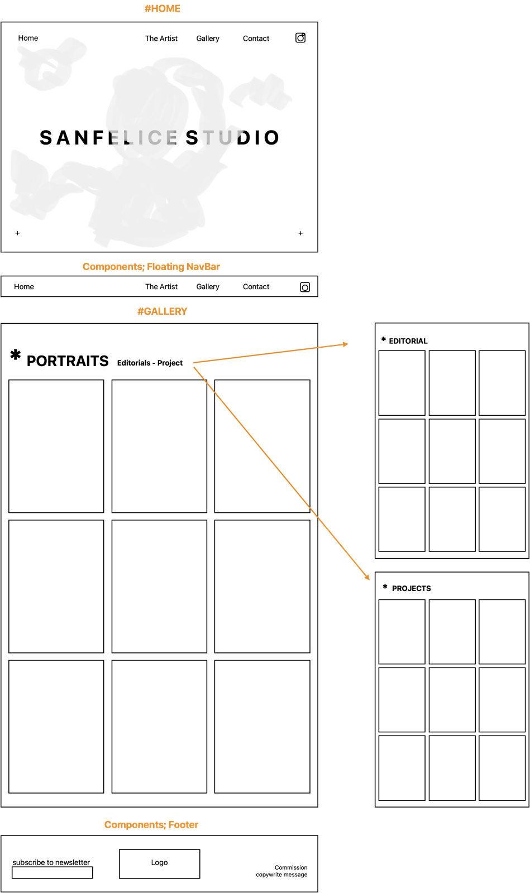 | 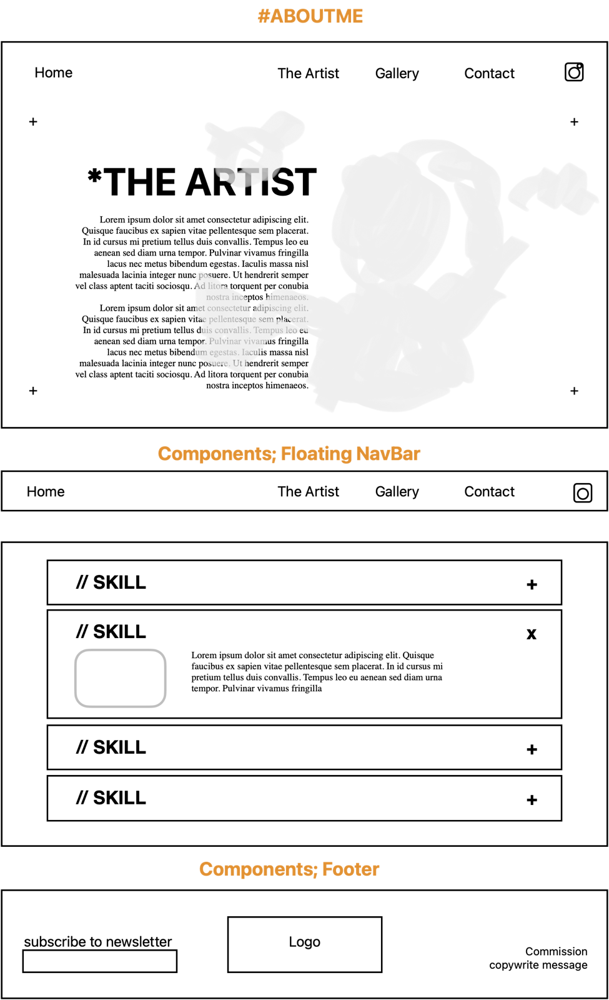 | 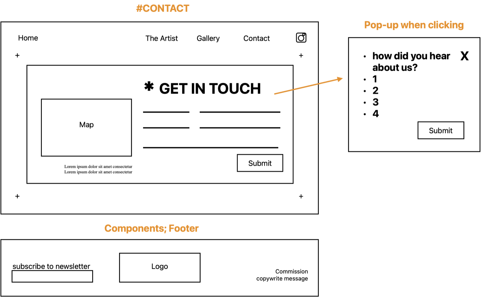 |

## Screenshots

All pages on desktop (1440 px wide) and mobile (390 px wide), taken from the live site.

| Page | Desktop | Mobile |
|---|---|---|
| Home |  | 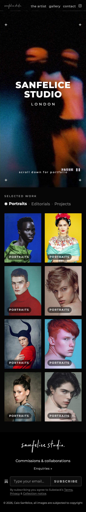 |
| The Artist | 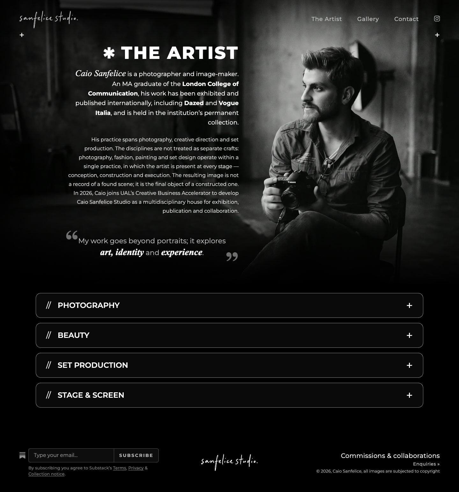 | 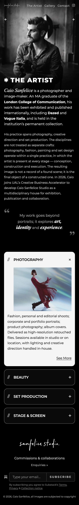 |
| Portraits | 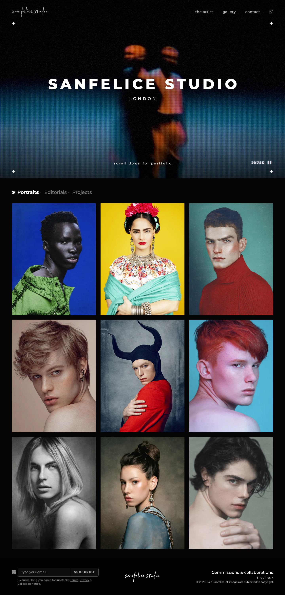 | 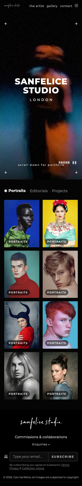 |
| Editorials | 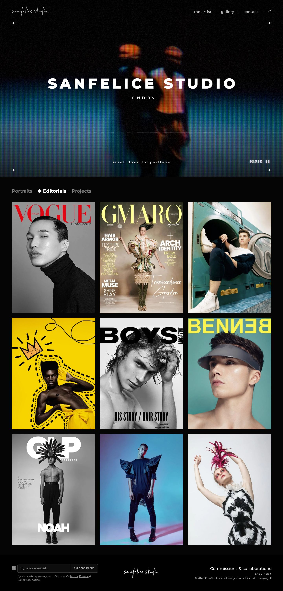 | 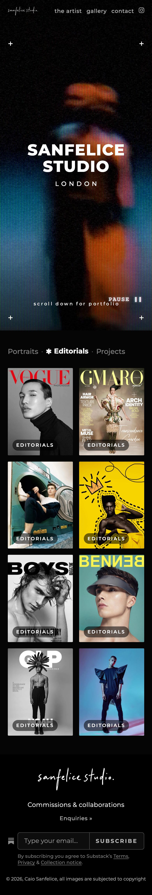 |
| Projects | 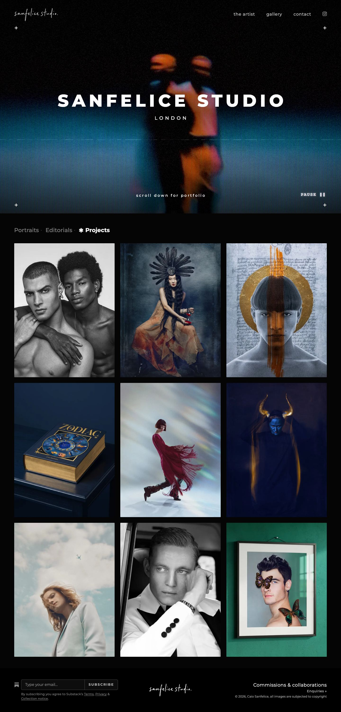 | 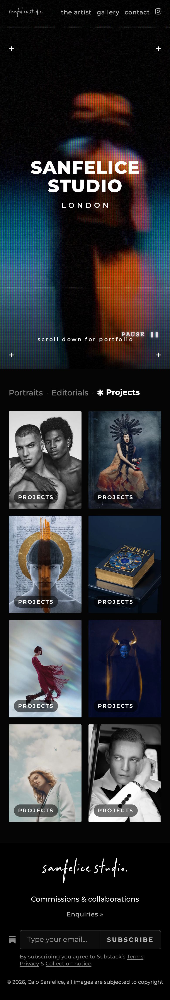 |
| Contact | 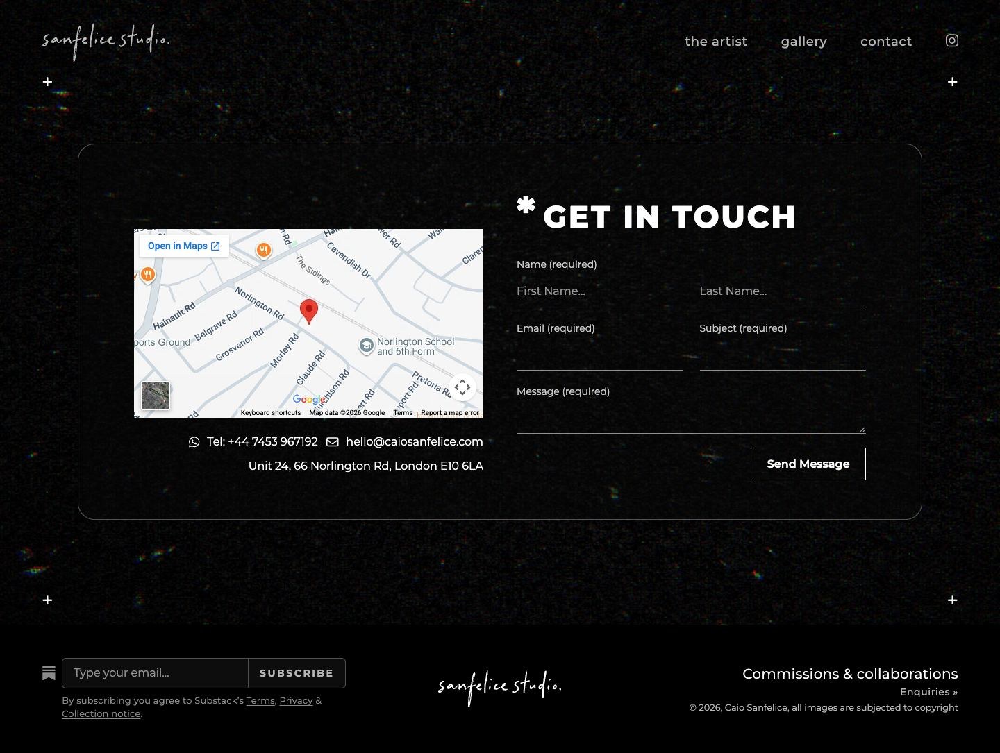 | 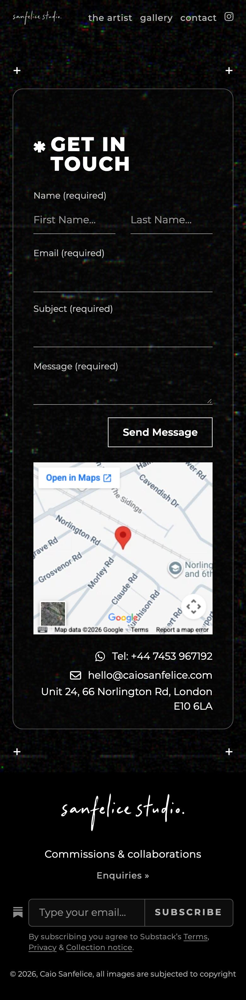 |

## Testing

Full details, including what was changed to pass each check, are in [VALIDATION.md](VALIDATION.md).

### HTML: W3C Markup Validation Service

All six pages pass with **no errors or warnings**. The shared navbar and footer were also validated inside a full HTML document.

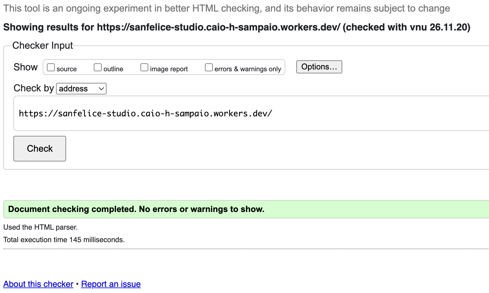

### CSS: W3C CSS Validation Service (Jigsaw)

`assets/css/style.css` passes as CSS level 3 + SVG with **no errors and no warnings**.

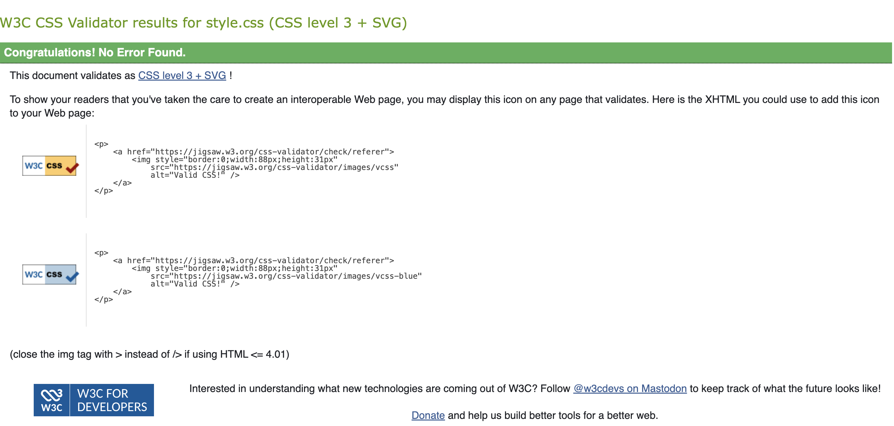

### Lighthouse

Every page scores **100** in Accessibility, Best Practices and SEO, on desktop and mobile. Performance is 92 to 99 on every page, on desktop and mobile; the full table is in [VALIDATION.md](VALIDATION.md).

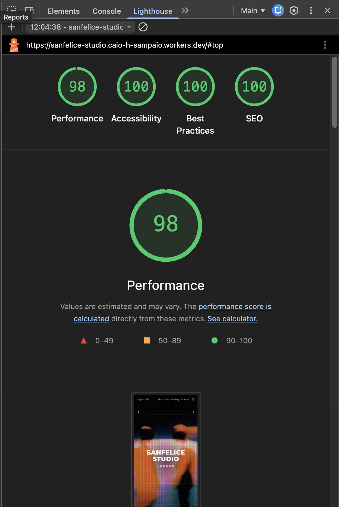

### Manual testing

| Test | Expected | Result |
|---|---|---|
| Navigation links on every page | Each link opens the right page; the current page is highlighted | Pass |
| Resize from 360 px to 1920 px | Layout adapts with no overlap, overflow or lost content | Pass |
| Click a gallery photo | Lightbox opens; closes with ×, Esc or a click outside | Pass |
| Pause button on the hero video | Video and effect pause, then play again | Pass |
| First click in the Contact form | "How did you hear about us?" pop-up opens; after an answer, the cursor returns to the field | Pass |
| Submit the Contact form empty | The browser asks for the required fields | Pass |
| Newsletter email without "@" | The browser shows an invalid-email message and does not send | Pass |
| Keyboard only (Tab, Enter, Esc) | Every link, button, card and form field can be reached and used | Pass |
| Reduced motion turned on | No video, effect or animations; still images instead | Pass |

## Bugs and Fixes

| Bug | Cause | Fix |
|---|---|---|
| The page jumped up while typing in the footer's email field | Scroll snap had no snap point at the bottom of the page, so focusing the field snapped back to the last section | Made the footer a snap point (`scroll-snap-align: end`) |
| On phones the navbar's Instagram icon was pushed off screen | The gap between links was 5 rem at every size | Smaller gaps and logo below 640 px |
| The Stage & Screen photo was stretched | The `height` attribute in the HTML overrode the CSS aspect ratio | `height: auto` on the card photos |
| The Contact pop-up appeared under its dark backdrop | It was inside `<main>`, which creates its own stacking context | Moved the pop-up outside `<main>` |
| 6 errors in the W3C CSS validator | Modern features the validator does not recognise yet (container queries, scroll-driven animation) | Rewritten with media queries and an `IntersectionObserver` |
| Two `alt` texts were cut short | Unescaped quote marks (`"`) inside the attribute | Written as `&quot;` |
| Lighthouse Performance 66 on desktop | The WebGL effect was set up while the page was still loading | The effect starts after the page has loaded |
| One Projects photo did not appear | The new photo was saved as `.png`, but the page asked for `.webp` | Converted to WebP with the expected file name |
| New high-resolution gallery photos added about 26 MB to the pages | The full-size exports were used directly in the gallery | Each photo now has a 720 px thumbnail for the gallery and a larger `-full` version (max 1800 px) that loads only when the photo is opened |
| Two photos showed a white border in the gallery | The border is part of the image file | Cropped from the gallery thumbnail only; the full photo with its border still opens in the lightbox |

**Known issues**

- The site must be opened through a web server (Live Server locally, or the live link). Opened straight from the file system (`file://`), the browser blocks loading the navbar and footer and the WebGL effect.

## Deployment

The site is a static website (HTML, CSS, JavaScript, images and video, no build step), hosted on **Cloudflare** and deployed automatically from GitHub.

1. Push the project to a GitHub repository.
2. In the Cloudflare dashboard, go to **Workers & Pages → Create**, connect the GitHub account and import the repository.
3. Set the production branch to `main`. No framework preset and no build command are needed; the site is served from the repository root, where `index.html` is.
4. Deploy. Cloudflare gives the site its public address.
5. From then on, every push to `main` publishes the new version automatically.

**Run it locally**

1. Clone the repository: `git clone https://github.com/caiohsampaio87/SANFELICESTUDIO.git`
2. Open the folder in VS Code and start **Live Server** on `index.html`. A local server is needed because the navbar and footer are loaded with `fetch()`.

## Credits

**Content**
- All photography, video, art direction, styling and texts: Caio Sanfelice. All images are subject to copyright.
- Magazine covers (Vogue Italia PhotoVogue, GMARO Magazine, Boys Magazine, BENNEB, GLP Carreiras) show work by Caio Sanfelice published by those magazines; the magazine names and logos belong to their owners.
- Hero background video: Caio Sanfelice.

**Code and services**
- [Bootstrap 5.3.9](https://getbootstrap.com/) (MIT licence): grid, utilities and Modal component.
- [Montserrat](https://fonts.google.com/specimen/Montserrat) from Google Fonts (SIL Open Font Licence).
- Instagram, WhatsApp and envelope icons: SVG from [Font Awesome Free](https://fontawesome.com/) (CC BY 4.0).
- VHS effect (`assets/js/vhs-glitch-bg.js`): written by the author in WebGL (GLSL shader).
- [Web3Forms](https://web3forms.com/) for the contact form, [Substack](https://substack.com/) for the newsletter, [Google Maps](https://www.google.com/maps) for the map.

## Use of AI

This project was built with the help of AI, as allowed by the course:

- **Claude (Anthropic), through Claude Code**, was used as a coding assistant to review the code, suggest and implement layout and accessibility improvements, move the layout to the Bootstrap grid, build the scroll and video effects, fix bugs, check the site with the W3C validators and Lighthouse, and draft this documentation.
- The design, content, photography and every decision about what went into the site are the author's. All AI suggestions were reviewed and tested in the browser before being kept.

## Future Updates

- Re-export the gallery images in several sizes with `srcset`, so phones download smaller files.
- A different hero video for each gallery page.
- A page for each project, with a full photo series.
- Online booking for sessions.
